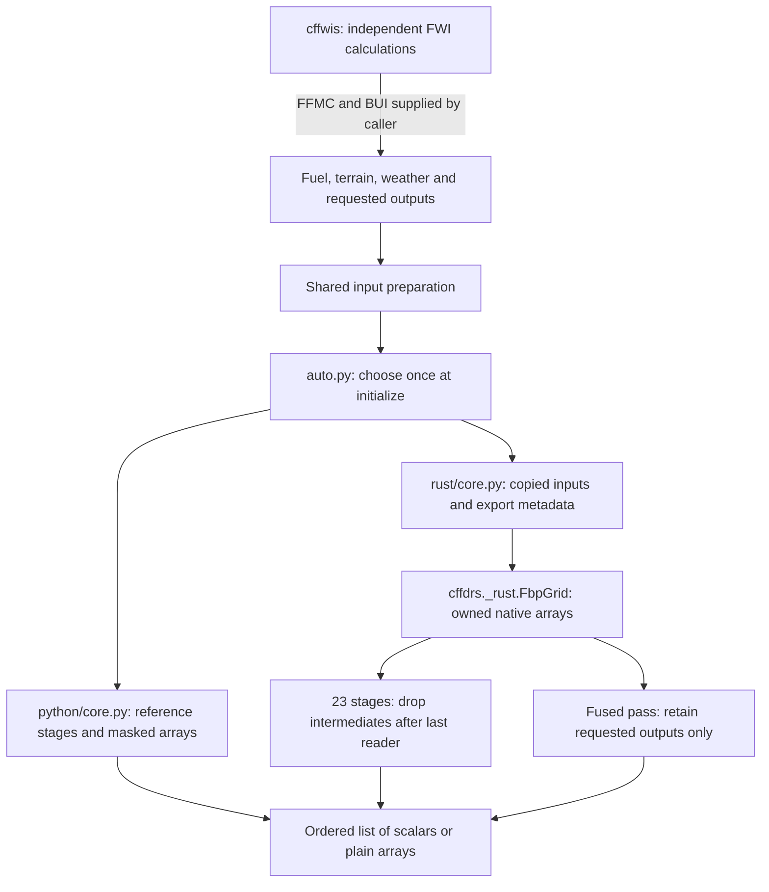

# cffdrs — Codebase Reference

Python implementation of the Canadian Forest Fire Danger Rating System: the Fire
Behaviour Prediction (FBP) System and the Fire Weather Index (FWI) System. Library
only — no server, no CLI, no event handlers. Scalar and NumPy-array inputs share
one API; missing/NoData values propagate via masked arrays. `uv`-managed; not yet
published to PyPI (the publish jobs are disabled). Maturin builds one mixed
Python/Rust `cp311-abi3` wheel; its version comes from `rust/crates/cffdrs-py/Cargo.toml`.
Two interchangeable FBP backends exist (Python reference, Rust); every known
difference between them is tracked in [BACKEND_DIFFERENCES.md](BACKEND_DIFFERENCES.md).

## Architecture overview

Two independent systems live side by side in one package:

- **`cffdrs.cffbps`** (FBP) — an automatic interface: `auto.py` selects Rust when importable, otherwise Python.
  `python/core.py` holds the `FBP` class; `common/` holds shared constants and
  input validation; `rust/core.py` wraps the owned native `FbpGrid`;
  `cupy/core.py` holds the experimental GPU backend.
  The Python class orchestrates pure,
  single-purpose equation functions in a fixed sequence. The `FBP` class holds no fire-behavior
  math itself; equation submodules never call across files — all wiring between
  quantities (e.g. crown fraction burned feeding into fuel consumption) happens in
  the `FBP` class's hardcoded call order.
- **`cffdrs.cffwis`** (FWI) — flat, independent module functions (no shared class).
  Legacy/untyped style, predates the `cffbps` typing conventions. Not called by
  `cffbps` internally — FBP takes FFMC/BUI as caller-supplied inputs.
- **`cffdrs.diurnal_ffmc_lawson`** — a separate hourly-FFMC algorithm (table
  interpolation from a daily 1200 FFMC), wrapped by `cffwis.diurnalFFMC_lawson()`.
  Unrelated to `cffwis.hourlyFFMC()` (Van Wagner/Alexander recursive model) — two
  independent hourly-FFMC methods coexist.

The codebase is a genuine two-tier system, not just old-vs-new file age:

| Tier | Files | Typing | Error handling |
|---|---|---|---|
| Modern, strict-mypy-gated | `cffbps/python/equations/*`, `cffbps/common/constants.py`, `_typing.py` | Fully typed, `from __future__ import annotations`, reST docstrings | `TypeError`/`ValueError` only for structural problems; domain issues handled via masking/clipping/`np.errstate` |
| Modern, typed but ungated | `cffbps/python/core.py`, `cffbps/common/inputs.py`, `cffbps/python/parallel.py` | Typed, excluded from strict mypy (dynamic dict access, masked-array narrowing fights numpy stubs) | Same masking-first philosophy as equations |
| Legacy/untyped | `cffwis.py`, `diurnal_ffmc_lawson.py` | Bypasses `_typing.py` entirely | Manual `isinstance` checks repeated per parameter, per function |

## Key files and responsibilities

### `cffbps/python/core.py` — the `FBP` class
- `initialize(...)` — accepts fuel/terrain/weather inputs (scalar or ndarray), calls
  `inputs.check_array()` then `inputs.verify_inputs()`, binds computed output attributes
  to one shared zero-filled `self.ref_array` template, raises `ValueError` if any of
  the 11 required params is missing.
- `runFBP()` — guards on `self.initialized`, resets computed state, then runs 23 named steps in a fixed
  hardcoded order, returns `self.getParams(out_request)`. Also validates the final
  `out_request` list against `constants.valid_outputs` and raises `ValueError` naming
  any unknown entries (documented via a `:raises:` line on the method).
- `calcX()` methods (one per equation-module function) — thin wrappers: read `self.*`,
  call one `equations.*` function, write result(s) back to `self.*`. Contract: return
  value field names must match facade attribute names (enforced by comment convention,
  not by code).
- `getParams(out_request)` — builds the 54-field output dict of every possible output, returns
  the requested subset; branches once on scalar-vs-array mode to unwrap results.
- `getSeasonGrassCuring(...)` — standalone lookup helper, not tied to an instance.

### `cffbps/common/inputs.py` — validation/coercion
Pure functions, no mutation of shared state. `check_array()` detects scalar-vs-array
mode and validates all array inputs share one shape. `_coerce()` wraps a single
value as a masked array (NaN → default for pc/pdf/gfl/gcf, NaN → masked for
everything else — deliberate, golden-snapshot-locked behavior). `verify_inputs()` is
the main entry, returns a `VerifiedInputs` NamedTuple whose field names match `FBP`
attributes by contract.

### `cffbps/python/parallel.py` — multiprocessing driver
`fbpMultiprocessArray(...)`: estimates block size from available memory
(`psutil`) and processor count, splits array inputs into non-overlapping blocks,
runs a fresh `FBP()` per block via `multiprocessing.Pool.starmap` (return-value
based, no shared memory/queues), stitches block results back into full output
arrays by position. `num_processors < 2` is bumped to 2 with a `warnings.warn(...)`
(not a `print()`); an invalid `out_request` raises inside the worker's `runFBP()`
call and propagates cleanly back out through `pool.starmap`, not swallowed.

### `cffbps/common/constants.py` — static lookup tables
Fuel-type code tables (numeric ↔ alpha), `valid_outputs`, per-fuel-type CBH/CFL/height
table, per-fuel-type ROS coefficients (`rosParams`), open/non-crowning fuel-type sets.
Wrapped immutable (`MappingProxyType`/`tuple`/`Final`). `core.FBP.__init__` copies these
into per-instance mutable attributes so one instance can be calibrated without
affecting others or the shared module table.

### `cffbps/python/equations/*` — pure calculation functions
One file per concern, all operating on `numpy.ma.MaskedArray` only (no separate
scalar path — scalars are coerced upstream):
- `slope_wind.py` — wind/slope geometry, zero-wind ISI, wind/slope-adjusted ISI, RSI, BUI effect
- `ros.py` — head/backing rate of spread, D2 handling, and separate C6 CROS/HROS equations
- `surface.py` — surface fuel consumption (one formula per fuel type/group)
- `crown.py` — CBH/CFL, CSFI, RSO, directional/temporary C6 blend CFB, fire type, CFC
- `consumption.py` — total fuel consumption, HFI, fire intensity class
- `fmc.py` — foliar moisture content and effect
- `growth.py` — growth-percentile ROS adjustment, point-ignition acceleration

Multi-value returns use `NamedTuple`s (`FMCResult`, `SlopeWindISI`, `ISIRSIBEResult`)
whose field names double as the facade attribute contract.

**`growth.calc_ros_percentile_growth`'s statistical basis.** `percentile_growth` is a percentile of the ROS
distribution (model error only), not a percent change: among fires with the same fuel, weather inputs and
fire type, the model implies about (100 - p)% spread at least as fast as the ROS at percentile p, so 75 gives
ROS reached or exceeded in about 25% of such fires and 25 gives ROS reached or exceeded in about 75%. 50 is the
unadjusted ROS. This holds for head fire in the adjusted fuels (C-1 to C-7); backing-fire noise is scaled down
by k(wind speed), and other fuels are unchanged. CFB, fire type, CFC, TFC and HFI are then recomputed from the adjusted
ROS; that chaining is a project extension, not part of the paper. Adjusts `hros`/`bros`
for a requested `percentile_growth` (0-100, no-op at 50 or `None`; values outside (0.001, 99.999) are capped to those bounds, NaN propagates) using the
variance-stabilized ROS quantile model of Han, L. & Braun, W.J. (2014), "Dionysus:
a stochastic fire growth scenario generator", *Environmetrics* 25(6):431-442. For
surface fires ROS residuals are treated as log-normal, so ROS is scaled by
`exp(tinv * 0.923)`; for crown fires a closed-form Box-Cox power-law adjustment
(`delta=0.6`, `sigma=1.637`) applies, `(ROS^0.6 + tinv * 1.637)^(1/0.6)`. The two
sigmas are the paper's pooled conifer estimates (the paper pools by category because
per-fuel-type data are sparse, and reports no per-fuel values). `tinv` is a
standard-normal quantile computed via `scipy.stats.t.ppf` at `freedom=9999999`, which
agrees with the exact normal quantile to about 1e-7 relative. `bros`'s noise term is
additionally scaled by a wind-speed decay factor `k(wsv)` (the paper's `k(w)`) —
backing-spread variability shrinks as wind speed increases, the same way backing ROS
itself does; head-fire noise is not wind-scaled.

*Project choices, not from the paper:* (1) the surface-vs-crown regime is chosen by
`cfb < 0.1`, using each direction's own pre-percentile CFB (`python/core.py`'s
`self.percentile_cfb`/`self.percentile_bros_cfb`), because the paper assumes the fire
type is known; (2) if the crown radicand goes negative the adjusted ROS is 0 (no positive ROS
exists there, and this keeps the output continuous and non-decreasing in ROS); (3) fuel scope: only C-1..C-7 are adjusted —
C-2, C-3, C-4, C-6 and C-7 in both regimes, C-1 in the crown regime only and C-5 in
the surface regime only (the paper has no per-fuel-type coverage, so this pattern is a
project decision, not derived from it); all other fuel types (D, M, O, S, NF, WA) are
unchanged, since the paper reports estimates for conifer fuels only (deciduous and
mixed data existed but were too sparse to report).

C6 completes its deterministic SROS/CFB/CROS blend before percentile growth. Generic
heading/backing CFB then uses the completed directional ROS for regime selection and
is recalculated from the adjusted ROS for final downstream outputs. Consequently, C6
backing CFB uses real BROS rather than reusing head-derived SROS.

### `cffwis.py` (~1150 lines) — FWI System
Flat functions: `dailyFFMC`, `hourlyFFMC`, `dailyDMC`, `dailyDC`, `dailyISI`,
`dailyBUI`, `dailyFWI`, `dailyDSR`, `startupDC`, `diurnalFFMC_lawson`. Only FFMC has
a distinct hourly variant — ISI/FWI reuse one equation for both cadences depending
on which inputs the caller passes. No shared typed helpers between functions; each
repeats its own `isinstance` checks and NaN-mask rebuilding.

### `diurnal_ffmc_lawson.py` — Lawson diurnal FFMC
Static RH-class lookup tables (`L`, `M`, `H`, `MAIN`, `RHCLASS`), sourced from
Lawson, Armitage & Hoskins (1996), FRDA Report 245, vectorized over
`numpy`/masked arrays. Main entry: `hourly_ffmc_lawson_vectorized(...)`.
Morning-hour (06:00-11:59) RH-class selection uses a half-hour-dependent
threshold column — see gotchas below.

### `_typing.py`
Shared aliases (`Scalar`, `ArrayLike`, `MaskedArray`, `FloatArray`) — explicitly the
newer convention; equation files still alias `MaskedArray` locally instead of
importing from here, and `cffwis`/`diurnal_ffmc_lawson` bypass it entirely.

### `tools/`
- `gen_fbp_goldens.py` — regenerates golden regression fixtures; run only from a
  known-good state.
- `generate_test_fbp_rasters.py` — builds `.tif` test fixtures (depends on an
  external `ProcessRasters` module not in this repo).
- `manual_fbp_test.py` — explicitly not part of the package or pytest suite; manual
  smoke test only.
- `compare_backends.py` — differential comparison of the Python and Rust backends over
  every fuel code, each input missing in turn, two percentiles and scalar / array /
  mixed input; its output is the basis of [BACKEND_DIFFERENCES.md](BACKEND_DIFFERENCES.md).
- `probe_integer_outputs.py` — records what the Python reference returns for the
  integer outputs at masked cells (the source of `integer_outputs_snapshot.json`).
- `bench_rust_grid.py`, `bench_rust_stages.py` — release-profile benchmarks of the fused
  grid pass and of the stepwise stages (time and memory); run on a quiet machine, three times.
- `smoke_test_wheel.py` — installs-and-checks a built wheel in a clean environment
  (used by the release workflow and locally for 3.11 / 3.14).

### `tests/`
- `tests/cffbps/` — `test_fbp_unit.py`, `test_fbp_regression.py` against Wotton et
  al. (2009) published cases and golden snapshots (`data/golden/`); raster fixtures
  under `data/inputs/` including a `multiprocessing/` subset and `cupy`/GPU output
  variants.
  - `test_fbp_unit.py` includes guardrail regression tests for: the own-and-return
    convention on `calc_cbh_cfl`/`calc_ros`/`calc_accel_param`/`calc_isi_rsi_be`; the
    `VerifiedInputs`/`ISIRSIBEResult` setattr-target contract, `FMCResult`'s
    positional-unpack field order, and `SlopeWindISI`'s fields being a subset of
    `ISIRSIBEResult`'s; unknown `out_request` names raising; `num_processors<2`
    warning (not printing); and NaN-to-default coercion for `pc`/`pdf`/`gfl`/`gcf`.
  - `test_fbp_regression.py`'s snapshot tests (layers 2/3) compare at **float32**
    precision, not exact float64 equality — absorbs 1-ULP platform libm/BLAS drift
    in trig-derived fields (`raz`, `wse`/`wse1`, `wsx`, `wsy`, `bros`) without masking
    real regressions (confirmed no real drift: casting the observed float64
    mismatches to float32 made them equal on both sides).
- Rust backend tests: `test_rust_parity.py` (native grid vs the golden snapshots),
  `test_rust_fbpgrid.py` (the `cffdrs._rust.FbpGrid` class), `test_rust_backend.py`
  (the `cffbps.rust.FBP` wrapper: outputs, update routes, lifecycle, integer exports,
  against `integer_outputs_snapshot.json` and `non_modeled_snapshot.json`),
  `test_auto_backend.py` (automatic dispatch) and `test_final_review_regressions.py`
  (stateful injections and scalar missing-input exports). `conftest.py` provides the
  backend fixtures that run the shared suites on Python and Rust.
- `rust/crates/cffbps-rust/tests/` — the bit-level oracle `characterization.rs` (local
  `#[ignore]` tool, baseline in `rust/target/`, never re-record it on a refactor), the
  golden tests, `grid_api.rs`, `threads.rs`, `stage_state.rs` and `fbp_grid.rs`.
- `tests/cffwis/` + `tests/test_cffwis.py` — includes a real BC weather-station
  dataset (Haig Camp) for validation, plus diurnal-FFMC-specific tests.

## Rust workspace (`rust/`)

A Cargo workspace beside `src/`, with no root `Cargo.toml` (always pass
`--manifest-path rust/Cargo.toml`):

- `crates/cffbps-rust` (0.3.0, MSRV 1.78, no runtime dependencies): the module map is in
  the crate docs (`src/lib.rs`): `fbp` (scalar `run()`), `field`/`stage`/`state` (75
  fields, 23 stages, one cell), `grid` (per-cell or constant inputs, any requested
  outputs, threads), `fbp_grid` (stages over whole grids with freeing) and one module
  per equation family mirroring `python/equations/`.
- `crates/cffdrs-py` (0.2.0): PyO3 bindings that build as `cffdrs._rust`
  (`run_fbp_grid` and the `FbpGrid` class); the Python wrapper is `cffbps/rust/core.py`.

## Data flow

The pure crate exposes `Field`, `Stage`, `CellState`, `GridInput` and `FbpGrid`.
`Stage::ALL` defines canonical order; `reads()`/`writes()` define dependencies.
The private extension `cffdrs._rust.FbpGrid` releases the GIL while doing native
work. Its wrapper supplies masks and reference export types; it does not replay
Python calculations. Engine-oriented `grid::run_grid` is separate from the
Python-compatible staged/fused interface, particularly for non-modeled cells.

### Lifecycle and memory

`out_request` pins fields required after execution. Staged Rust retains only
requested outputs and intermediates needed by later planned stages; it drops a
computed array after its last reader. Inputs remain owned for reset/reuse.
Reading a freed field raises an error naming the field and suggesting adding it
to `out_request`. Reading a never-computed field uses its initial template:
zero except NaN for `ffc`/`wfc`/`sfc`; `d0`/`dj` without computation or explicit
override export NaN, and `wd`/`aspect` read their raw inputs before inversion.
Freed and never-computed are different states. Out-of-order stages may consume
templates or raise a freed-read error; they do not reconstruct missing history.

Both backends' `reset()` discards computed/injected values and preserves current
inputs, explicit overrides and output requests. `runFBP()` starts from that same
clean state, so repeated runs are idempotent and discard computed-field injections.
Fused Rust retains only requested outputs; stages after it raise `AfterFused`
(exposed as `RuntimeError` requesting `reset()`). Reset before resuming stages.
Python retains intermediate attributes and allows stages after a full run.

Rust copies all inputs. Modify them with assignments or `setParams`, `set`,
`set_fuel`, `set_param`, and `set_override`; editing the caller's original array
in place does not update Rust. Python retains array references and sees such edits.
Canopy injection belongs after `getCBH_CFL` and before its readers; a subsequent
full run resets it. Computed Rust fields are read with `getParams`, not attributes.
The aliases used for injection are `bfW` and `accel_param`; exports use `bfw` and `accel`.

### Fields and stages

There are 75 per-cell fields: 54 public outputs, 12 input-only fields and nine internal fields.
The following reference follows the current `field.rs` and `stage.rs`; their tests
validate read/write completeness. `wx_date` and `percentile_growth` are scalar
parameters, not per-cell fields.

| Group | Names |
|---|---|
| Public outputs (54) | `ws wd wse wse1 wse2 wsx wsy wsv raz m fF fW ffmc isi bui a b c q bui0 be be_max sf rsz rsf isf rsi latn dj d0 nd fmc fme ffc wfc sfc cfl cfc tfc cbh csfi rso cfb fire_type hros sros cros bfw bisi bros hfi fi_class accel fuel_type` |
| Input-only (12) | `lat long elevation slope pc pdf gfl gcf d0_override dj_override wd_in aspect_in` |
| Internal (9) | `isz brsi c6_blend_cfb c6_blend_cfc percentile_cfb percentile_bros_cfb bros_cfb hros_growth_nan aspect` |

`wd_in`/`aspect_in` are raw angles; `wd`/`aspect` are inverted working values.
`hros_growth_nan` tracks only a NaN introduced by percentile growth; other HROS
writers clear it. Final CFB uses this provenance to preserve Python sanitization.
The fixed per-fuel tables are read in addition to the listed per-cell inputs.

| Stage (Python method name) | Reads | Writes |
|---|---|---|
| `invertWindAspect` | wd_in, aspect_in | wd, aspect |
| `calcSF` | slope | sf |
| `calcISZ` | ffmc | m, fF, isz |
| `calcFMC` | lat, long, elevation, d0_override, dj_override | latn, d0, dj, nd, fmc, fme |
| `calcISI_RSI_BE` | fuel_type, gcf, isz, sf, pc, pdf, bui, fF, wd, aspect, ws | a, b, c, q, bui0, be_max, rsz, rsf, isf, rsi, brsi, be, wse1, wse2, wse, wsx, wsy, wsv, raz, fW, bfw, isi, bisi |
| `calcROS` | rsi, brsi, be, bui, sros, fuel_type | hros, bros, sros, hros_growth_nan |
| `calcSFC` | fuel_type, ffmc, bui, pc, gfl | ffc, wfc, sfc |
| `getCBH_CFL` | fuel_type, cbh, cfl | cbh, cfl |
| `calcCSFI` | fuel_type, cbh, fmc | csfi |
| `calcRSO` | sfc, csfi | rso |
| `calcC6BlendCFB` | fuel_type, sros, rso | c6_blend_cfb |
| `calcC6BlendCFC` | fuel_type, c6_blend_cfb, cfl, pc, pdf | c6_blend_cfc |
| `calcC6CROS` | fuel_type, c6_blend_cfc, isi, fme, cros | cros |
| `calcC6HROS` | fuel_type, sros, cros, c6_blend_cfb, hros, hros_growth_nan | hros, hros_growth_nan |
| `calcPercentileCFB` | fuel_type, rso, hros, bros | percentile_cfb, percentile_bros_cfb |
| `calcRosPercentileGrowth` | fuel_type, percentile_cfb, percentile_bros_cfb, wsv, hros, bros | hros, bros, hros_growth_nan |
| `calcCFB` | fuel_type, rso, hros, hros_growth_nan, bros | cfb, bros_cfb |
| `calcAccelParam` | fuel_type, cfb, accel | accel |
| `calcFireType` | fuel_type, cfb | fire_type |
| `calcCFC` | fuel_type, cfb, cfl, pc, pdf | cfc |
| `calcTFC` | hros, ffc, wfc, sfc, cfc | ffc, wfc, sfc, cfc, tfc |
| `calcHFI` | hros, tfc | hfi |
| `calcFireIntensityClass` | hfi | fi_class |

## Python reference assumptions and gotchas

- **Shared-template output binding is load-bearing.** `initialize()` pre-binds ~40
  computed output attributes to one shared zero-filled `self.ref_array`. This only stays safe
  because every `calcX()` *reassigns* the whole attribute rather than mutating it in
  place ("own-and-return" convention). Any new equation code that mutates a masked
  array in place instead of returning a new one would silently corrupt other
  attributes sharing the same template. Guarded by a regression test
  (`test_equations_do_not_mutate_input_arrays`) covering `calc_cbh_cfl`, `calc_ros`,
  `calc_accel_param`, and `calc_isi_rsi_be` — extend it if new equation code takes a
  template argument.
- **NamedTuple field names are an unenforced contract, and not all consumed the same
  way.** `VerifiedInputs`/`ISIRSIBEResult` field names must exactly match the `FBP`
  attribute names they get `setattr`'d onto (via `._asdict()`) — nothing type-checks
  this, a renamed field silently creates a dead attribute instead of raising.
  `FMCResult` is consumed differently: it's unpacked *positionally*
  (`self.latn, self._d0_res, ... = fmc_eq.calc_fmc(...)`), so a field reorder (not a
  rename) is the failure mode there. `SlopeWindISI` is internal to
  `calc_isi_rsi_be` only — its fields are folded one-by-one into `ISIRSIBEResult`,
  never touching the facade directly. Each pattern has its own guardrail test in
  `test_fbp_unit.py` (`test_setattr_namedtuples_match_facade_attributes`,
  `test_fmc_result_field_order_matches_positional_unpack`,
  `test_slope_wind_isi_fields_are_wired_into_isi_rsi_be_result`).
- **`runFBP()`'s 23-step order is hardcoded and order-dependent.** Each step reads
  `self.*` attributes written by earlier steps (e.g. final `calcCFB` depends on
  percentile-adjusted ROS, which depends on completed C6 HROS and `calcRSO`).
  Reordering or skipping a step will
  silently use stale/zero values from the template rather than failing loudly.
  `out_request` only controls what `getParams()` returns — it does **not** skip
  unneeded calculation steps; all 23 always run.
- **Unknown fuel-type keys fail hard, not gracefully.** `crown.calc_cbh_cfl`'s
  lookup-table indexing (`cbh_cfl_ht_lut[ftype]`) is explicitly documented in-code as
  intentionally unvalidated — an unrecognized `ftype` raises a bare `KeyError`, not a
  friendly `ValueError`.
- **NaN vs. default semantics differ by field.** In `inputs._coerce()`, a NaN scalar
  for `pc`/`pdf`/`gfl`/`gcf` is silently replaced with a field-specific default; a NaN
  scalar for any other field becomes *masked* instead. This split is explicitly
  described as deliberate and golden-snapshot-locked — don't "fix" one path to match
  the other without regenerating goldens. Now actually exercised by
  `test_nan_optional_fields_use_documented_defaults` (previously only documented in
  a docstring, never tested).
- **Missing inputs propagate as NaN, in both implementations.** A masked (NaN) input
  stays masked through `sfc`/`rso`/`ffc`/`wfc`/`tfc` (and, at percentiles other than
  50, through the percentile-adjusted ROS when the regime CFB is missing). Equation
  code must select with `mask.where`, never plain `np.where`, which drops the mask and
  exposes the finite data numpy.ma arithmetic leaves under it. The Rust core and the
  grid binding match Python exactly here (`tests/cffbps/test_missing_inputs.py`,
  `test_rust_parity.py`).
- **Two independent hourly-FFMC algorithms coexist** (`cffwis.hourlyFFMC` — Van
  Wagner/Alexander recursive; `diurnal_ffmc_lawson` via `cffwis.diurnalFFMC_lawson` —
  table interpolation from a daily 1200 FFMC). They are not interchangeable and not
  cross-validated against each other in this codebase.
- **`out_request` values are the only sanctioned output-selection mechanism**, drawn
  from `constants.valid_outputs` (~54 names, includes intermediates like `isi`,
  `wsv`, `raz`, `sfc`, `fmc`, `csfi`, `rso`, `be`). Requesting a name outside this set
  now raises `ValueError` naming the bad value(s), rather than silently returning
  `np.nan` for that slot.
- **Scalar mode round-trips through masked arrays.** Even scalar calls get wrapped as
  1-element `MaskedArray`s internally and unwrapped via `.item()` at the very end
  (`getParams`). Any equation code added must stay masked-array-only — it cannot
  assume/branch on "this is a plain Python float."
- **`rosParams` has fuel-type-specific gaps.** M-1/M-2 entries use `None` for
  `a`/`b`/`c` — those coefficients are computed dynamically elsewhere. Code iterating
  `rosParams` generically must handle that `None` case rather than assuming numeric.
- **`num_processors < 2` in `fbpMultiprocessArray` is silently bumped to 2**, not
  raised — now surfaced via `warnings.warn(...)` rather than `print()`, so it's
  visible to `pytest.warns`/logging capture/`-W error` instead of only showing up in
  captured stdout.
- **Golden snapshots are the refactor safety net, not the equations code itself.**
  `tools/gen_fbp_goldens.py` explicitly warns previously-committed goldens were once
  stale (predating real behavior fixes) — regenerating them from a bad state would
  bake the bug in as the new "expected" behavior. Always confirm a known-good state
  first. The snapshot comparison itself is at **float32 precision** (not exact
  float64 equality) — different numpy/BLAS/libm builds can disagree in the last 1-2
  digits of a float64's ~16 significant digits for trig-derived fields
  (`raz`/`wse`/`wsx`/`wsy`/`bros`), which is platform noise, not drift; float32 still
  carries ~7 significant digits, so a real regression still fails the test.
- **`equations/__init__.py` re-exports nothing** — every equation function must be
  imported from its specific submodule (`from cffdrs.cffbps.python.equations.crown import
  calc_cfb`), not from the `equations` package itself.
- **Two hourly test-fixture surfaces for the same system**: `cffwis` tests live both
  under `tests/cffwis/` and as a separate `tests/test_cffwis.py` at the repo root of
  `tests/` — check both when validating FWI changes, it's easy to update one and miss
  the other.
- **Lawson diurnal FFMC's morning RH-class threshold is keyed to the half-hour,
  not just the hour.** `diurnal_ffmc_lawson.hourly_ffmc_lawson_vectorized`'s
  morning branch (06:00-11:59) must pick the RH-class (L/M/H) threshold column at
  `tindex - 1` when `minute <= 30` and `tindex` when `minute > 30` — one column
  earlier than the hour-row interpolation index. Using a single `tindex` for both
  purposes (the bug fixed here) silently misclassifies RH values near a class
  boundary for the first 30 minutes of every morning hour. Regression-locked by
  `test_hourly_ffmc_lawson_vectorized_rh_class_uses_half_hour_offset`.
- **C6 has three distinct CFB roles; do not feed the final value back into the blend.**
  `c6_blend_cfb` is derived from SROS only to calculate deterministic blended C6
  HROS. `percentile_cfb`/`percentile_bros_cfb` are then calculated generically
  from completed HROS/BROS to select the percentile-growth regimes. Finally,
  `cfb`/`bros_cfb` are recalculated from adjusted HROS/BROS. Only final heading
  CFB drives acceleration, fire type, CFC, TFC, and HFI; final backing CFB is
  retained as directionally consistent facade state. Rerunning the C6 blend with
  final CFB would overwrite percentile-adjusted HROS and reintroduce the original
  ordering bug.

- **No fuel is consumed when the fire does not spread.** `calcTFC` (the last consumption
  step, after the crown calculations have used `sfc`) sets `ffc`, `wfc`, `sfc`, `cfc` and
  `tfc` to 0 where the head ROS is exactly 0 (for example D-2 with BUI < 70, or an injected
  `hros` of 0), and to NaN where the ROS is NaN, even for fuels whose `sfc` does not itself
  use the missing input (a missing FFMC or wind makes `sfc` NaN). Because it runs in
  `calcTFC`, reading `sfc` before that step still gives the formula value, and `rso`,
  `cfb` and the fire type are not affected. Non-fuel, water and invalid fuel cells have a
  NaN ROS, so their consumption stays NaN. Python: `consumption.zero_without_spread`; Rust:
  `consumption::without_spread` (fused `run()` and the stage engine); the experimental CuPy backend
  applies the same rule in its `calcTFC`, checked only through a NumPy stand-in for `cupy`
  (`tests/cffbps/test_cupy_consumption.py`), not on a GPU.

## Outputs and intentional differences

Both high-level backends return an ordered list. Array entries are plain NumPy
arrays, with NaN at missing floating results, never masked arrays. Integer field
masks follow observed Python exports: `fire_type=0`, `fi_class=-99`, retained
prepared fuel code beneath its mask, and derived `dj` independent of fuel masks.
Masked longitude/elevation can instead give derived `dj=0`.

Most computed floats are float64. Integer `ws`/`ffmc`/`bui`/inverted `wd` and
integer `d0`/`nd` can retain integer dtypes, as can explicit injected results.
Prepared array fuel is generally int8; scalar fuel mixed with grid inputs can
retain int64. `fire_type`/`fi_class` arrays are int64. A complete `dj` is int64;
missing override cells require float64 with NaN. Unknown getter names return NaN;
invalid `out_request` values are rejected by the full-run interface.

All-scalar exports are Python scalars, with measured legacy exceptions: invalid
fuel and selected masked computations can export float zero rather than nominal
integer values. Inapplicable scalar FFC/WFC may export zero; non-fuel/water
CBH/CFL/CFC remain NaN. An explicit missing date exports NaN for d0/dj/FMC/FME.
Classification uses the mask of the HFI actually consumed: masked scalar HFI can
export float zero, whereas unmasked infinite or finite injected HFI retains its
integer classification. Acceleration likewise follows the produced field and
retained fuel mask, not a universal mask conversion.

Rust expands every output to the full grid shape and treats 0-d inputs as scalars.
Python may keep scalar-derived fields at `(1,)` and can export legacy memoryview
values for 0-d inputs. Scalar fuel mixed with full-grid Python inputs also has a
known coefficient-indexing defect; parity comparisons broadcast fuel explicitly.
Floating results match to rtol 1e-9, integer results exactly. The integer snapshot
and backend tests preserve conditional types and per-field missing values.

The design decisions D12(a)-(d) are resolved as follows:

- D12(a): both backends now derive inverted angles from raw inputs. Repeated full
  runs or repeated inversion no longer flip twice.
- D12(b): both FMC implementations reflect current inputs and explicit date
  overrides. Exact-input caches reuse unchanged results; cache arrays are private.
- D12(c): full-grid Rust output shape and 0-d handling remain intentional differences.

Every known difference is tracked individually in [BACKEND_DIFFERENCES.md](BACKEND_DIFFERENCES.md),
which also says how to re-run the comparison (`tools/compare_backends.py`).
- D12(d): fuel validation keeps masks, checks codes before narrowing and masks
  fractional/out-of-range codes instead of truncating or wrapping them.

All five D13 reference fixes landed: fuel validation, idempotent angles, the FMC
contract, reset/full-run lifecycle, and normalization of updated inputs. The nine
normalized inputs (`slope aspect ws ffmc bui pc pdf gfl gcf`) use the same rules
through initialize, assignment, setters and stage arguments.

`set_override('d0', value)` and `set_override('dj', value)` accept scalars, arrays,
masked arrays or None to clear. `setParams`, assignments and `calcFMC` date arguments
use those routes; omitted arguments preserve overrides. `dj` is floored and clipped
to 1..365 or 1..366 for the weather year, with the shared clipping warning once per
supplied-value/year pair; infinity is rejected and missing cells remain missing.
`d0` is a model parameter and is deliberately not calendar-clipped.

## Breaking changes in 0.2.0

These old paths are historical migration references, not current imports:

| Previous location | Current location |
|---|---|
| `cffdrs.cffbps.facade` | `cffdrs.cffbps.python.core` |
| `cffdrs.cffbps.equations` | `cffdrs.cffbps.python.equations` |
| `cffdrs.cffbps.parallel` | `cffdrs.cffbps.python.parallel` |
| `cffdrs.cffbps.inputs`, `.constants` | `cffdrs.cffbps.common.inputs`, `.constants` |
| `cffdrs.cffbps.cupy_backend` | `cffdrs.cffbps.cupy` |
| Rust package `cffdrs-core`, module `cffdrs_core` | package `cffbps-rust`, module `cffbps_rust` |

There are no deep-import compatibility shims. The root FBP import now selects the
backend once at initialization; explicit Python/Rust imports remain available.
The distribution version is 0.2.0 (`cffdrs-py`); the core API version is 0.3.0.
`GridInput` numeric fields use `PerCell::Const` or `PerCell::Cells`, and optional
per-cell d0/dj overrides. Its fuel field remains a code slice. Consumers of the
old scalar/slice struct shape must adapt; `run_grid_fields` can select arbitrary fields.

Rust does not implement per-instance table calibration, Python result attribute
reads, canopy lookup override arguments, block processing or Python multiprocessing.
Choose `backend='python'` for those operations. The automatic wrapper rejects
unsupported operations without switching or replaying. Calibration table access
before initialization pins Python. Canopy injection on Rust uses setters after
its lookup stage; result reads use `getParams`.

### Upgrading PyroCell

PyroCell vendors a frozen copy and does not automatically gain this release by
updating an installed cffdrs wheel. Update its `inv vendor` task, which hard-codes
the historical single-file `cffbps.py`, to copy the modular `cffbps/` tree with
`common/`, `python/` and their package files. Decide explicitly whether its frozen
integration will include the Rust facade and an installed extension or use the
explicit Python backend. Preserve the import layout rather than copying core.py alone.

Update the custom `run_model` sequence using the 23-stage table above:

1. Replace the historical `calcC6hros` call with `calcC6BlendCFB`,
   `calcC6BlendCFC`, `calcC6CROS`, and `calcC6HROS` in that order.
2. Compute directional pre-growth CFB with `calcPercentileCFB` before
   `calcRosPercentileGrowth`; call `calcCFB` again after growth for final CFB.
3. Follow final CFB with acceleration, fire type, CFC, TFC, HFI and intensity class.
   If CFB was calculated earlier in the custom pipeline, that earlier value is
   not the final post-growth value. Retain all Rust outputs needed after stages
   in `out_request`, and reset before stages after a fused run.

## Versions, delivery and branch routing

Maturin reads distribution 0.2.0 from `rust/crates/cffdrs-py/Cargo.toml`; the
independent Rust core is 0.3.0. Release tag validation continues to read the
binding version. Both publishing jobs remain disabled. CI uses `cffbps-rust`
and its existing pytest command now covers both CPU backends; no jobs or schedules
were added for this change.

A prebuilt wheel avoids Rust compiler installation for Python consumers. Source
builds require Rust 1.78 or newer (the MSRV, enforced in CI) and platform build tools.
The ABI3 wheel tag is cp311-abi3 (PyO3 0.27); supported Python is 3.11-3.14
(`requires-python >= 3.11`), CI runs the suite on 3.12 and the release workflow
smoke-tests wheels on 3.11-3.14 for Linux x86-64, macOS x86-64 and arm64, and Windows
x86-64. Future CPython ABI compatibility
is not certification of future NumPy/SciPy dependencies. Free-threaded builds
are unsupported. This local version has not been published by this work.

The existing v0.1.0 tag activates contribution routing: this minor-version work
targets `pre_release`; the owner later reviews `pre_release` into `master`.
Commits, pushes, tags and publication still require separate authorization.
`docs/CONTRIBUTION_PROCEDURES.md` exists only on `docs/contribution-procedures`,
so that branch needs a follow-up docs-only patch targeting `master`: record the
v0.1.0 tag, rename the old core paths/mutation diff command to `cffbps-rust`,
and name `pre_release` as the target for minor versions. No other branch was edited.